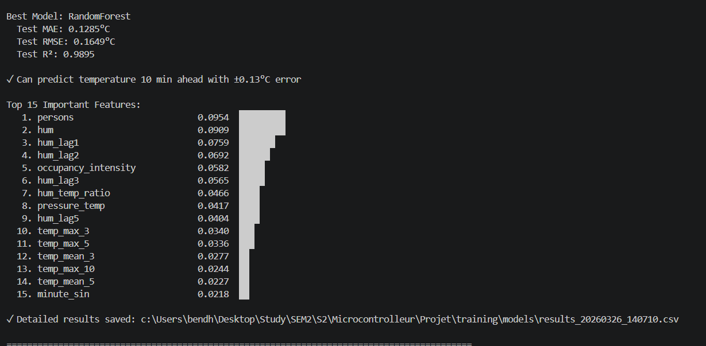

# Smart Classroom Temperature Prediction

A Flask application for monitoring classroom conditions and occupancy. It connects an ESP32 sensor device to a browser dashboard, uses a trained machine-learning model to generate temperature predictions, and supports RFID-based attendance and fan control.

## Features

- Live sensor updates and dashboard views for temperature, humidity, pressure, and motion.
- Temperature predictions using the model artifacts loaded by the application.
- ESP32 data reporting and RFID verification.
- User registration, login, email verification, and password reset.
- Role-based administrative pages and RFID/user management.
- Manual and automatic fan-control settings.
- Firebase Realtime Database integration and Socket.IO updates.

## Project layout

```text
.
├── app.py
├── database/          # Authentication, Firebase, email, and scheduling
├── esp32_client/      # Arduino sketches for the ESP32
├── static/            # CSS and JavaScript
├── templates/         # Flask/Jinja pages
├── .env.example       # Environment configuration template
└── requirements.txt
```

## Requirements

- Python 3.8 or later
- A Firebase service-account JSON file and a Firebase Realtime Database
- The trained model artifacts listed below
- For hardware integration: an ESP32 and compatible sensors/readers

## Setup

1. Clone the repository and enter its directory.

   ```bash
   git clone https://github.com/nourbendhif/Temperature_Ai_Prediction.git
   cd Temperature_Ai_Prediction
   ```

2. Create and activate a virtual environment.

   **Windows (PowerShell):**

   ```powershell
   py -m venv .venv
   .venv\Scripts\Activate.ps1
   ```

   **macOS/Linux:**

   ```bash
   python3 -m venv .venv
   source .venv/bin/activate
   ```

3. Install the Python dependencies.

   ```bash
   python -m pip install -r requirements.txt
   ```

4. Create a local environment file by copying `.env.example` to `.env`. Set a unique `FLASK_SECRET_KEY` and configure `FIREBASE_CREDENTIALS` to point to your Firebase service-account JSON file. Keep `.env` and the credential file private; do not commit them.

5. Configure Firebase:
   - Create a Firebase project and enable the Realtime Database.
   - Create a service-account key with the required database access.
   - Save the JSON file locally and set `FIREBASE_CREDENTIALS` to its path. Relative paths are resolved from the project directory.
   - Set `FIREBASE_DATABASE_URL` to your Realtime Database URL. If omitted, the application derives the default URL from the service-account project ID.
   - Keep service-account JSON files private; the repository ignores common Firebase admin-key filenames.

6. Provide the model files under a `models/` directory at the project root:

   ```text
   models/
   ├── model_BEST_RandomForest_20260326_140710.pkl
   ├── scaler_20260326_140710.pkl
   └── features_20260326_140710.pkl
   ```

   These artifacts are not included in this repository. The application expects these exact filenames when it starts.

### Optional email configuration

Email verification and password-reset messages require SMTP credentials. Configure these values in `.env`:

```dotenv
SMTP_SERVER=smtp.gmail.com
SMTP_PORT=587
SENDER_EMAIL=your-address@example.com
SENDER_PASSWORD=your-app-password
APP_URL=http://localhost:5000
```

Use an app-specific password where your provider requires one. Without sender credentials, the application logs a warning and cannot send email.

## Run locally

Start the application from the project root:

```bash
python app.py
```

Open [http://localhost:5000](http://localhost:5000). The built-in startup configuration runs Flask-SocketIO in debug mode and listens on all interfaces at port `5000`; use it for local development, not as-is for a public production deployment.

## ESP32 setup

1. Install ESP32 board support in the Arduino IDE and the libraries required by the sketch.
2. Open `esp32_client/esp32_code.ino`.
3. Set the Wi-Fi network and password, and update `server_url` to the Flask host and port reachable from the ESP32.
4. Select the appropriate ESP32 board and port, then upload the sketch.
5. Wire the sensors and optional RFID reader according to the wiring notes in the sketch.

The ESP32 sketch currently uses a BME280 for environmental readings, a PIR sensor for motion, and an MFRC522 RFID reader. Keep network credentials out of public commits.

## Model training results

The reported best model is a Random Forest evaluated on the test set. The training report shows:

| Metric | Result |
| --- | ---: |
| Test MAE | 0.1285 °C |
| Test RMSE | 0.1649 °C |
| Test R² | 0.9895 |
| Forecast horizon | 10 minutes |

The report describes the 10-minute forecast error as approximately ±0.13 °C. The most influential features include occupancy (`persons`), humidity (`hum`), recent humidity readings, and occupancy intensity.



## Main pages and API

| Purpose | Route |
| --- | --- |
| Sign in / registration | `/login`, `/signup` |
| Dashboard | `/dashboard` |
| Statistics and prediction history | `/stats`, `/predictions-history` |
| Administration and settings | `/admin`, `/settings` |
| Receive ESP32 sensor data | `POST /api/sensor-data` |
| Request a prediction | `POST /predict` |
| Verify an RFID tag | `POST /api/rfid/verify` |
| Read latest sensor data | `GET /api/sensor/latest` |
| Read latest prediction/history | `GET /api/predictions/latest`, `GET /api/predictions/history` |
| Read occupancy and attendance | `GET /api/occupancy`, `GET /api/attendance` |
| Read or update fan controls | `/api/fan/status`, `/api/fan/config`, `/api/fan/command`, `/api/fan/control`, `/api/fan/settings` |

Administrative API routes are grouped under `/api/admin/`. For request fields and response formats, refer to the route handlers in `app.py`.

## Troubleshooting

- **Firebase does not connect:** Check that the credential file exists, that `FIREBASE_CREDENTIALS` points to it, and that the Firebase project has Realtime Database enabled.
- **Model loading fails:** Ensure all three model files are present in `models/` with the exact filenames above, and check compatibility with the pinned scikit-learn version.
- **ESP32 cannot reach the server:** Confirm both devices are on a network that permits communication, and that `server_url` uses the computer's reachable LAN address and port `5000`.
- **Email is not sent:** Verify the `SMTP_*`, `SENDER_*`, and `APP_URL` values and your email provider's SMTP/app-password requirements.

## Security notes

- Replace the example Flask secret with a strong, unique value before running the application.
- Never commit Firebase service-account keys, email credentials, or `.env` files.
- The development server is not a production deployment configuration. Use a production-ready server and review network exposure, secret handling, and access controls before deploying.
